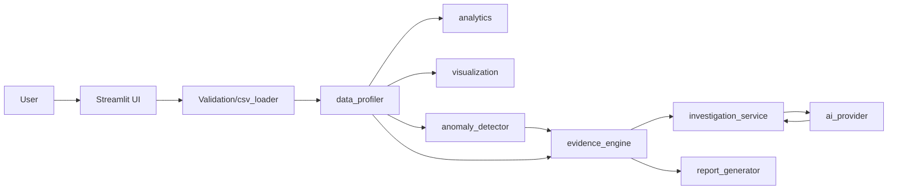

# System Design — AEGIS X

## Problem statement
Users need to move from raw CSV data to understandable, evidence-backed findings
without trusting an LLM to invent statistics.

## Goals
- Deterministic analytics with Pandas/NumPy
- AI explanations grounded in calculated evidence
- Traceable findings with row references
- Graceful degradation without AI

## Non-goals
- Autonomous law enforcement, guaranteed misinformation detection, replacement for human judgment

## Architecture

## Components
- csv_loader: parsing, validation, normalization
- data_profiler: types, missingness, summaries
- analytics: stats, correlations, group comparisons
- visualization: Plotly charts on real data
- anomaly_detector: IQR, Z-score, missingness
- evidence_engine: Finding model, provenance
- ai_provider: OpenAI-compatible client (Nebius/NVIDIA)
- investigation_service: context building, validation of AI output
- report_generator: Markdown + CSV

## Data flow
Upload -> validate -> profile -> analyze -> detect anomalies -> build findings -> (optional) AI explanation -> report.

## AI request/response flow
Bounded context from calculated summaries + findings -> model -> JSON parse -> validate finding IDs -> display.

## Evidence provenance
Each Finding has ID, type, summary, metric, columns, row refs, method, confidence, limitations, timestamp. Row refs are positional indices in current dataset.

## Security boundaries
- Server-side keys only
- No execution of uploaded content
- Size/row/column limits
- Redacted errors

## Failure handling
- AI unavailable -> deterministic features continue
- Invalid CSV -> clear errors
- Small samples -> notes

## Privacy/retention
In-memory only; no persistence of uploads.

## Known limitations
See README.